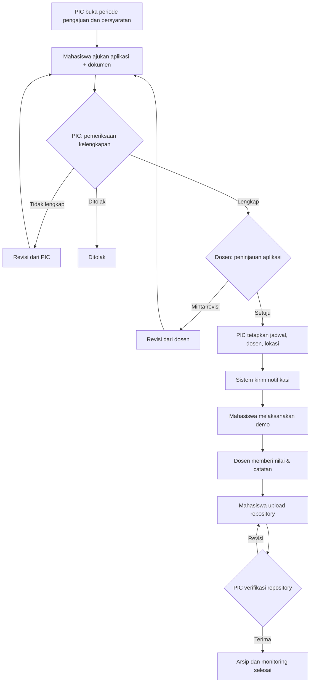

# Alur Proses dan Status SPDA v2

## Alur bisnis

> Tahap unggah dan approval repository adalah ekstensi dari penjelasan awal, sementara BAB 2.5 dokumen terbaru hanya menyebut monitoring dan pengarsipan setelah evaluasi.

## State machine yang diterapkan

| Status teknis | Label UI | Pelaksana aksi berikutnya | Kemungkinan berikutnya |
|---|---|---|---|
| `PENDING_PIC` | Pemeriksaan PIC | PIC | `PENDING_DOSEN`, `REVISION_PIC`, `REJECTED` |
| `REVISION_PIC` | Revisi dari PIC | Mahasiswa | `PENDING_PIC` |
| `PENDING_DOSEN` | Peninjauan Dosen | Dosen | `READY_TO_SCHEDULE`, `REVISION_DOSEN` |
| `REVISION_DOSEN` | Revisi dari Dosen | Mahasiswa | `PENDING_PIC` |
| `READY_TO_SCHEDULE` | Siap Dijadwalkan | PIC | `SCHEDULED`; jika dosen diganti, `PENDING_DOSEN` |
| `SCHEDULED` | Demo Terjadwal | Dosen / PIC | `DEMO_DONE`; PIC bisa ubah jadwal atau ganti dosen |
| `DEMO_DONE` | Telah Dievaluasi | Mahasiswa | `SUBMITTED` |
| `SUBMITTED` | Menunggu Verifikasi PIC | PIC | `COMPLETED`, `SUBMISSION_REVISION` |
| `SUBMISSION_REVISION` | Revisi Repository | Mahasiswa | `SUBMITTED` |
| `COMPLETED` | Selesai | — | terminal |
| `REJECTED` | Ditolak | — | terminal |
| `CANCELLED` | Dibatalkan | — | disiapkan untuk ekstensi, tombol pembatalan belum tersedia |

## Master dan transaksi

- **Master:** `AppUsers` (akun dan role), `DemoPeriod` (periode dan persyaratan), metadata aplikasi dalam `DemoRequests` (judul/deskripsi).
- **Transaksi:** `DemoRequests` (pengajuan dan jadwal), `DemoFiles` (dokumen dan repository), `DemoHistory` (pemeriksaan, peninjauan, evaluasi, keputusan), `DemoNotifications` (notifikasi pengguna). Evaluasi juga tersimpan pada kolom `LecturerScore` dan `LecturerNotes`.
- Tanggal disimpan sebagai `DATETIMEOFFSET` dan frontend menampilkan WIB (`Asia/Jakarta`).
- PIC menentukan jadwal akhir. Mengganti dosen mengulang peninjauan dan menghapus jadwal yang belum terlaksana agar tidak ada persetujuan dosen yang tidak berlaku.
- Status lama versi 1 `APPROVED` dimigrasikan menjadi `SCHEDULED` agar data historis tidak hilang, walaupun belum menjalani peninjauan baru.
